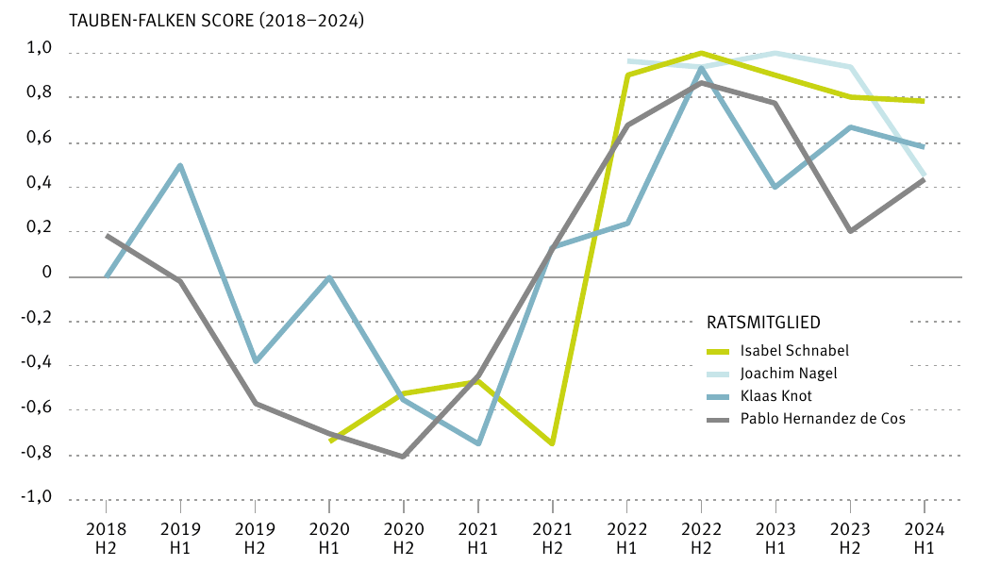
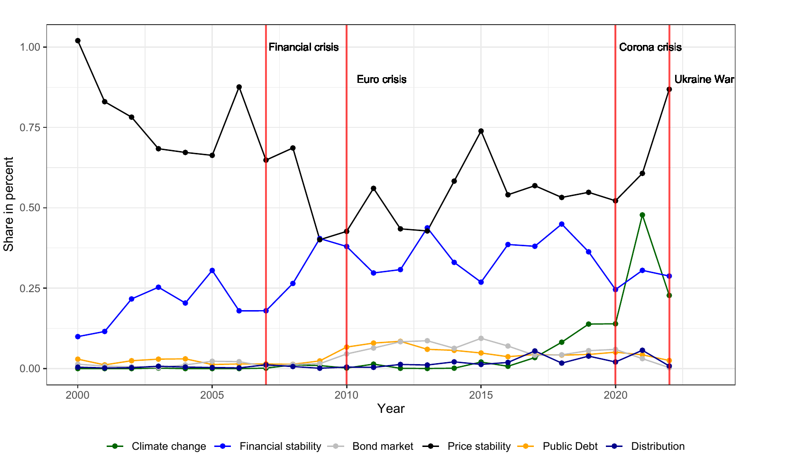

## Dashboard

**ZEW ECB-Monitor**: *coming soon*

## Policy Briefs

**ECB Monitor Quarterly Report Q3 2026**\
Friedrich Heinemann, Jan Kemper\
ZEW ECB Monitor, Mannheim, 2026\
[PDF](https://ftp.zew.de/pub/zew-docs/ecb_monitor/ZEW-ECB-Monitor-2026-Q3.pdf) · [ZEW page](https://www.zew.de/publikationen/ecb-monitor-quarterly-report-q3-2026)

::: {.callout-note collapse="true"}
## Abstract

The escalation of the Iran conflict in early 2026 raised uncertainty about the inflation outlook, as higher energy prices and supply-chain disruptions revived fears of second-round effects in the euro area. Governing Council communication turned sharply hawkish over spring and early summer, then moderated in July amid greater growth pessimism. More recently, energy prices have stayed high while euro area growth has surprised on the upside. This report assesses the outlook for ECB monetary policy through the lens of Council members' communication. The ECB-ZEW Momentum Indicator uses an AI-based classification of individual speeches to track whether the Council's tone is shifting towards tighter or looser policy. This edition covers data up to 27 August 2026.
:::

---

**ECB Monitor Quarterly Report Q2 2026**\
Friedrich Heinemann, Jan Kemper\
ZEW ECB Monitor, Mannheim, 2026\
[PDF](https://www.zew.de/fileadmin/FTP/ecb_monitor/ZEW-ECB-Monitor-2026-Q2.pdf) · [ZEW page](https://www.zew.de/publikationen/ecb-monitor-quarterly-report-q2-2026)

::: {.callout-note collapse="true"}
## Abstract

The escalation of the Iran conflict in early 2026 raised uncertainty about the inflation outlook, as higher energy prices and supply-chain disruptions revived fears of second-round effects in the euro area. Ahead of its monetary policy meeting on 11 June 2026, the ECB Governing Council faced a difficult choice: holding the deposit rate at 2%, cutting it to support a slowing economy, or raising it to keep inflation in check. To gauge how Council members were communicating ahead of this decision, the ZEW ECB Monitor tracks the tone of individual speeches using an AI-based text classification. This report summarises the key findings from the latest data update.
:::

---

**Falke oder Taube in der Nachfolge von Christine Lagarde an der EZB-Spitze? Einsichten aus einer KI-Analyse öffentlicher Reden**\
*Hawk or Dove as Christine Lagarde's Successor at the Head of the ECB? Insights from an AI Analysis of Public Speeches* (in German)\
Friedrich Heinemann, Jan Kemper\
ZEW policy brief Nr. 26-05, Mannheim, March 2026\
[PDF](https://www.zew.de/fileadmin/FTP/policybrief/de/pb05-26.pdf)

{.policy-figure fig-alt="Line chart of hawk–dove scores from 2018 to 2024 for Isabel Schnabel, Joachim Nagel, Klaas Knot and Pablo Hernández de Cos. All scores turn sharply hawkish in 2022."}

::: {.callout-note collapse="true"}
## Abstract

Christine Lagarde's term as ECB President ends in October 2027, and four candidates are most often named as her successor: Pablo Hernández de Cos, Klaas Knot, Joachim Nagel and Isabel Schnabel. We use a large language model to score their public speeches on a scale from −1 (extreme dove) to +1 (extreme hawk). In 2022–2024, when all four sat on the ECB Governing Council at the same time, all of them speak as hawks, with Schnabel and Nagel the most focused on fighting inflation. Over a longer horizon, Schnabel, Knot and de Cos all turned sharply hawkish in 2021–22, but only Schnabel kept this position. Overall, a de Cos presidency would point towards a more expansionary course, Nagel or Knot would largely continue Lagarde's line, and Schnabel would signal a more determined fight against inflation.
:::

---

**Inflation of Objectives Instead of Focus on Inflation? Evidence on the ECB Objective Function from a Textual Analysis**\
Friedrich Heinemann, Jan Kemper\
ZEW Expert Brief Nr. 22-07, Mannheim, October 2022\
[PDF](https://zew.de/fileadmin/FTP/ZEWKurzexpertisen/EN/ZEW_Shortreport2207.pdf)

{.policy-figure fig-alt="Line chart of the share of speech terms devoted to price stability, financial stability, bond markets, public debt, climate change and distribution from 2000 to 2022, with the financial crisis, euro crisis, Corona crisis and Ukraine war marked."}

::: {.callout-note collapse="true"}
## Abstract

We analyse more than 3,800 speeches by ECB Governing Council members from 1999 to 2022 to measure how much attention they pay to price stability and to other possible objectives: financial stability, sovereign bond market stability, public debt, climate protection and distribution. Using a new central-bank dictionary built with machine learning and expert knowledge, we track these objectives over time, across countries and across individual Council members. Financial stability gained weight after the financial crisis, and public debt and bond markets after the euro crisis. Climate protection was almost absent until 2015, yet by 2021 more than half of all speeches mentioned it. Governors from Southern Europe speak less about price stability than their colleagues. The growing range of objectives may signal a loss of focus, and suggests the ECB should rethink its communication at a time of high inflation.
:::
